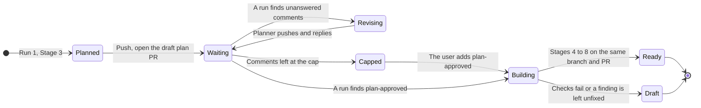
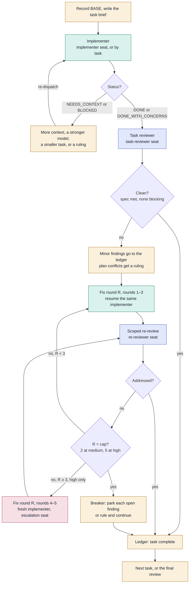
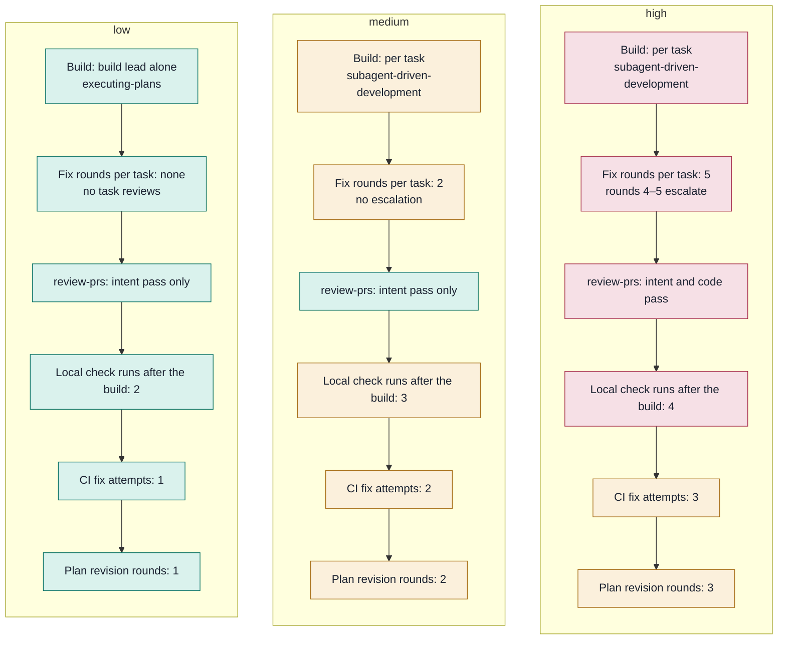
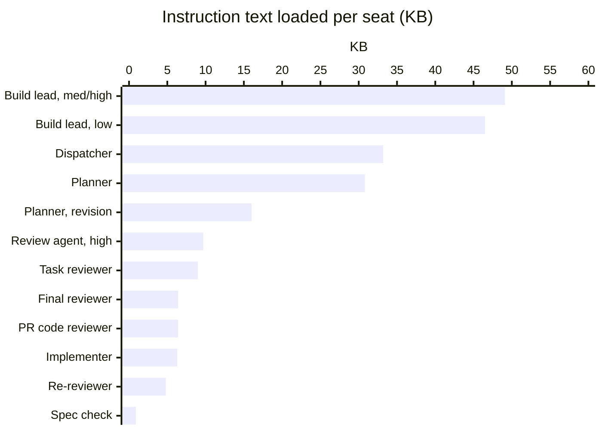
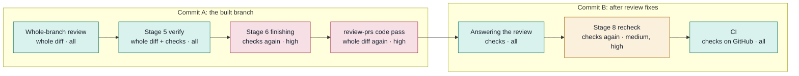

# How implement-issues builds one issue

This traces one issue through `implement-issues`, from the queue to a ready
pull request. It covers every agent the skill starts, which seat each one
fills, what each one loads, and where the same work repeats at each effort
level. Use it as the map when you change the skill's cost or speed, or the
models it uses. Why the flow looks like this is in
[the delivery settings design](superpowers/specs/2026-10-17-delivery-settings-design.md).

It describes the skills as written on 17 October 2026: `implement-issues`
(with its assets), `review-prs`, `answer-pr-reviews`, `fetch-issues` and
`superpowers-issue-bridge` from this repo, plus Superpowers 7.0.0's
`brainstorming`, `writing-plans`, `subagent-driven-development` (SDD),
`executing-plans`, `test-driven-development`, `requesting-code-review`,
`receiving-code-review`, `finishing-a-development-branch` and
`verification-before-completion`. When one of those skills changes, update
this file too.

## The three settings

- **Effort** — `low`, `medium` or `high`. It comes from the run's argument
  (`/implement-issues low`), else the Effort line in the target repo's
  `docs/agents/delivery.md`, else a question in Stage 2. It decides how the
  plan is built and how much reviewing and checking follows.
- **Plan approval** — on or off, from `docs/agents/delivery.md`, asked in
  Stage 2 when the file has no line for it. When on, each issue's spec and
  plan wait on a draft plan PR until the user adds the `plan-approved` label,
  and a later run builds them.
- **Models** — one per agent: Planner, Build lead, Implementers, Task
  reviewers, Review agent and PR code reviewer, from the Agents table in
  `docs/agents/delivery.md`, or all six at once from a preset — `budget`,
  `balanced` or `max`. A Seats row still overrides one seat inside its agent.
  The Review agent alone may run on a local Codex, read-only. See
  [Every model seat](#every-model-seat).

`implement-issues` asks for what the file doesn't settle and offers to save
the answers, showing the diff first. The optional `setup-delivery` skill
writes the same file ahead of time, for anyone who'd rather decide once.

## At a glance

For one issue whose plan has N tasks, with a spec written and before any fix
round:

| | low | medium | high |
| --- | :---: | :---: | :---: |
| Agents started | **5** | **2N + 5** | **2N + 6** |
| Full code reads of the branch diff after the build | **2** | **2** | **3** |
| Full local check runs after the build | **2 + CI** | **3 + CI** | **4 + CI** |
| Model seats the user can set | **10 of 10** | **10 of 10** | **10 of 10** |

A small change, where brainstorming writes no spec, starts one agent fewer:
there is no spec check. The check counts assume the review has findings to
answer; see [Where the same work repeats](#where-the-same-work-repeats).

> **Before.** Until effort levels, plan approval and per-seat models were
> added, every issue got today's `high` flow on one issue agent: 2N + 5
> agents, 3 full code reads, 4 + CI check runs, and 1 of 12 model seats the
> user could set — the implementer.

## Who runs what

Time runs downward. Each column is one agent, or a group of them. The shaded
bands are the skill's stages. Each participant names the seat in
`docs/agents/delivery.md` that sets its model; the dispatcher is the user's
own session and has no seat.

```mermaid
sequenceDiagram
    autonumber
    participant D as Dispatcher<br/>session model
    participant P as Planner<br/>planner seat
    participant B as Build lead<br/>build-lead seat
    participant I as Implementers<br/>implementer, escalation seats
    participant T as Task reviewers<br/>task-reviewer, re-reviewer,<br/>final-reviewer seats
    participant R as Review agent<br/>pr-reviewer seat
    participant C as PR code reviewer<br/>pr-code-reviewer seat
    participant GH as GitHub

    rect rgba(128, 128, 128, 0.10)
    Note over D,GH: Stages 1–2 · Queue and settings
    D->>GH: fetch-issues, then each issue's open PRs and branches
    D->>D: Read delivery.md. Sort: plan, revise the plan, build, waiting, skip
    D->>D: Print effort, plan approval, every seat's model. Check each model
    D->>D: Ask what the file doesn't settle, offer to save it. Sequential or parallel
    end

    Note over D,T: Stage 3 · Plan
    D->>P: planner-brief.md with the full issue body
    P->>P: Bridge seeds brainstorming. It answers its own questions and sizes the work
    opt Brainstorming writes a spec, for a project
        P->>P: Builder check on the spec-check seat, part of the Planner agent
    end
    P->>P: writing-plans, carrying the Intent-Issue line
    P-->>D: Report: spec and plan committed, decisions

    alt Plan approval on
        D->>GH: Push, create the plan-approved label if missing
        D->>GH: Open a draft plan PR from plan-pr-body.md
        Note over D,GH: The issue waits and the run moves on
        Note over GH: Later, the user comments on lines or adds plan-approved
        loop Each later run that finds unanswered comments, up to 1, 2 or 3 rounds
            D->>P: planner-brief.md naming the plan PR
            P->>GH: answer-pr-reviews: run checks, push the revised spec and plan, reply
            P-->>D: Report: each comment and its answer
            D->>GH: Comment "Plan revision n of cap"
        end
        Note over D,GH: A later run finds plan-approved and builds on the same branch
    else Plan approval off
        Note over D,B: The build starts in the same run
    end

    rect rgba(128, 128, 128, 0.10)
    Note over D,T: Stage 4 · Build
    D->>B: build-brief.md: spec, plan, effort, five Superpowers seat models
    alt Low effort
        B->>B: executing-plans: builds every task itself, test-first
    else Medium or high effort
        loop Each of the plan's N tasks, see the per-task loop
            B->>I: Implementer for the task; escalation for fix rounds 4–5
            B->>T: Task review and re-review, fix rounds up to 2 or 5
            T-->>B: Task complete, rulings, deferred minor findings
        end
    end
    B->>T: Whole-branch review on the final-reviewer seat
    opt Final review has findings
        B->>B: One fix pass. Under SDD, one fix dispatch and one scoped re-review
    end
    B-->>D: Report: status, decisions, left undone. Stops before finishing
    end

    Note over D: Stage 5 · Verify
    D->>D: Read git log and the diff. Tests, lint, typecheck to log files
    opt A check fails
        D->>B: One message with the failures, then verify again
    end

    rect rgba(128, 128, 128, 0.10)
    Note over D,GH: Stage 6 · Draft PR
    D->>D: finishing-a-development-branch. Its suite run only at high, or if HEAD moved
    alt Approved plan PR
        D->>GH: Push to its branch, give it the delivery title and body. Still a draft
    else No plan PR
        D->>GH: Push, open a draft PR from pr-body.md
    end
    end

    Note over D,GH: Stage 7 · Review
    D->>R: review-prs on the PR. Code pass off below high
    R->>GH: Read the PR, its intent issue, existing comments
    R->>R: Intent pass
    opt High effort
        R->>C: code-reviewer.md over the branch diff
        C-->>R: Findings
    end
    R->>R: Open the code behind each finding to confirm it
    R->>GH: Post a COMMENT review
    R-->>D: Review URL

    rect rgba(128, 128, 128, 0.10)
    Note over D,GH: Stage 8 · Answer and mark ready
    opt The review has findings
        D->>B: answer-pr-reviews, in the same worktree
        B->>GH: Fix each item in its own commit, run checks, push, reply to each
        opt Medium or high, or low with no CI
            D->>D: verification-before-completion: checks on the pushed head
        end
    end
    D->>GH: gh pr checks --watch
    loop CI fails, up to 1, 2 or 3 attempts
        D->>B: Failing check's name and log
        B->>GH: Fix, commit, push. Never force
        D->>D: Checks again at medium and high
        D->>GH: gh pr checks --watch
    end
    D->>GH: gh pr ready
    end

    Note over D: Stage 9 · Report
    D->>D: One table: effort, plan state, every seat's model
```

### A plan PR across runs

With plan approval on, the issue's state lives on GitHub between runs. Each
run's Stage 1 reads it from the plan PR — the open PR whose body holds
`<!-- implement-issues: plan -->`.



A run that finds neither the label nor new comments leaves the plan PR
waiting. A capped plan PR waits for the user: the next run won't revise it
again. Adding the label is the only way forward from there, and only the
user adds it.

### Stage by stage

1. **Build the queue** — dispatcher.
   - `fetch-issues` lists the open issues with their full bodies, kept for
     dependency detection.
   - Reads the tracker config's Linking section and `docs/agents/delivery.md`.
   - Sorts each issue by what it finds: a plan PR labeled `plan-approved` →
     build; a plan PR with unanswered comments → revise the plan; any other
     plan PR → waiting; any other PR or branch → skip; nothing → plan.
   - Orders dependent issues and fetches the base branch.
2. **Settle the settings** — dispatcher.
   - Prints the effort and where it came from, plan approval, and every
     seat's resolved model. A model the platform's dispatch doesn't accept
     stops the run.
   - Asks only for what the file doesn't settle — effort when the run had no
     argument, plan approval, the implementer's model — then offers to save
     the answers to `docs/agents/delivery.md`, diff first.
   - Asks sequential or parallel, and how many at once.
3. **Plan** — planner, one per issue.
   - Creates `feat/<ref>-<slug>` or `fix/<ref>-<slug>` and its worktree, and
     fills `planner-brief.md` with the full issue body.
   - The planner seeds `brainstorming` through `superpowers-issue-bridge` and
     lets it size the work. A project gets a spec and a builder check on the
     spec-check seat. A small change gets no spec: its description opens the
     plan. Several projects or a spike stop as `NEEDS_DESIGN_SESSION`.
   - `writing-plans` writes the plan; the planner commits both and stops.
   - With plan approval on, the dispatcher pushes and opens a draft plan PR.
     A revision planner runs `answer-pr-reviews` on it, and the dispatcher
     counts each round with a `plan revision` comment.
4. **Build** — build lead, one per issue.
   - Fills `build-brief.md` with the spec, the plan, the effort, and the
     models for five Superpowers seats.
   - Low: `executing-plans`, every task built by the build lead itself,
     test-first. Medium and high: SDD, with the per-task loop below.
   - Every effort ends with the whole-branch review on the final-reviewer
     seat, plus one fix pass if it finds anything.
   - Reports and stops before `finishing-a-development-branch`.
5. **Verify** — dispatcher.
   - Reads `git log` and the diff, runs tests, lint and typecheck into log
     files, and reads back only exit codes, summaries and failing tails.
   - On a failure, sends the build lead one message, then verifies again.
6. **Open the draft PR** — dispatcher.
   - `finishing-a-development-branch` with its menu already answered. Below
     high, Stage 5's run counts as its suite run when HEAD hasn't moved.
   - An approved plan PR becomes the issue's PR: new commits, new title and
     body, still a draft. Otherwise a new draft from `pr-body.md`.
7. **Review the PR** — a new review agent on the pr-reviewer seat.
   - When the Review agent is on Codex, the dispatcher gathers the PR, its
     comments and the issue into files, runs `review-prs` in report-only
     mode through `codex exec -s read-only`, and posts the one review it
     returns. Codex never writes.
   - Runs `review-prs`: the intent pass at every effort. The code pass, on
     the pr-code-reviewer seat, only at high; below high the review body says
     it was skipped because the build's whole-branch review covered the code.
   - Confirms each finding against the code, then posts a `COMMENT` review.
8. **Answer and mark ready** — build lead, then dispatcher.
   - With findings, the build lead runs `answer-pr-reviews` in its worktree:
     a commit per fix, checks, push, a reply to every comment.
   - The dispatcher re-runs the checks on the pushed head at medium and high.
     At low, CI is the evidence, unless the PR has no CI.
   - It waits for CI and sends failures back to the build lead, up to 1, 2 or
     3 attempts, then runs `gh pr ready`.
9. **Report** — dispatcher. One table across all issues, with the effort,
   the plan state, and the model each seat ran on, then one question for each
   PR that left work undone.

## The per-task loop

This loop runs inside SDD once per plan task, at medium and high effort only.
At low effort there is no loop: the build lead builds each task itself and no
one reviews a task on its own. The fix-round cap is 2 at medium and SDD's own
5 at high, so escalation — rounds 4 and 5 — happens only at high.



Colors: amber is the build lead, on the build-lead seat; teal is the
implementer seat; blue is the task-reviewer and re-reviewer seats; rose is
the escalation seat. A seat the settings leave out follows SDD's own Model
Selection.

## Effort, side by side

Each column is one effort level; each row is one thing effort decides.
Darker boxes cost more.



| | low | medium | high |
| --- | --- | --- | --- |
| Build mode | one agent, `executing-plans` | per task, SDD | per task, SDD |
| Fix rounds per task review | — | 2 | 5 |
| `review-prs` code pass | off | off | on |
| Local check runs after the build | 2 | 3 | 4 |
| CI fix attempts | 1 | 2 | 3 |
| Plan revision rounds | 1 | 2 | 3 |

At every effort: Superpowers' whole-branch review ends the build, the
dispatcher runs the full checks before the first push, the review is answered
once by the build lead, and nothing merges.

## Every model seat

Most users set the six agents, or a preset, rather than seats: each agent
sets the seats grouped under it — Planner (planner, spec-check), Build lead
(build-lead), Implementers (implementer, escalation), Task reviewers
(task-reviewer, re-reviewer, final-reviewer), Review agent (pr-reviewer) and
PR code reviewer (pr-code-reviewer). A seat resolves from a run override,
then its Seats row, then its agent's row, then the preset, then the fallback
in the last column below.

These are the ten seats in `docs/agents/delivery.md`. Each value is a tier
(`cheap`, `standard`, `strong`, looked up in the file's Tiers table for the
platform), `session`, an exact model name, or — for the implementer only —
`by-task`. The dispatcher is not a seat: it is the user's own session.

| Seat | Runs at | How many per issue | Dispatched by | When not set |
| --- | --- | --- | --- | --- |
| planner | every effort | 1, plus 1 per plan revision | `implement-issues` | session model |
| spec-check | every effort, when a spec is written | 0–1 | the planner, in `brainstorming` | brainstorming's own rule: it names no model, so the planner's |
| build-lead | every effort | 1, kept to answer the review and CI | `implement-issues` | session model |
| implementer | medium, high | N, plus re-dispatches | the build lead, in SDD | asked in Stage 2 |
| task-reviewer | medium, high | N | the build lead, in SDD | SDD's rule: scaled to the task |
| re-reviewer | medium, high | 1 per fix round, plus 1 after the final fix | the build lead, in SDD | SDD's rule: cheap to mid |
| escalation | high | 0–2 per task | the build lead, in SDD | SDD's rule: a tier above the implementer |
| final-reviewer | every effort | 1 | the build lead, in SDD or `executing-plans` | that skill's rule: most capable |
| pr-reviewer | every effort | 1 | `implement-issues` | session model |
| pr-code-reviewer | high | 1 | the review agent, in `review-prs` | `review-prs`' rule: most capable |

The briefs name every seat's model explicitly, including `session`. For the
five seats Superpowers dispatches, that is an instruction to its controller
rather than a guarantee, so the build lead's report and the run's report
record the model each seat actually ran on.

## What each seat loads

This counts skill and prompt text only, measured from the installed files on
17 October 2026. Code, diffs, issue bodies and test output come on top of it.
Tokens are estimated at four characters per token.



| Seat | Runs | KB | ≈ tokens | Made of |
| --- | --- | ---: | ---: | --- |
| Build lead, medium or high | 1, held through review and CI | 49.1 | 12k | SDD 32.6, answer-pr-reviews 7.1, receiving-code-review 6.2, build brief 3.2 |
| Build lead, low | 1, held through review and CI | 46.5 | 12k | executing-plans 20.4, test-driven-development 9.6, answer-pr-reviews 7.1, receiving-code-review 6.2, build brief 3.2 |
| Dispatcher | 1 per run | 33.2 | 8k | implement-issues 17.5, finishing-a-development-branch 7.8, fetch-issues 4.3, verification-before-completion 3.6 |
| Planner | 1 per issue | 30.8 | 8k | writing-plans 10.3, brainstorming 10.1, bridge 7.7, planner brief 2.7 |
| Planner, revision | 1 per round | 16.0 | 4k | answer-pr-reviews 7.1, receiving-code-review 6.2, planner brief 2.7 |
| Review agent | 1 | 9.7 at high, 6.7 below | 2k | review-prs 6.7, plus requesting-code-review 3.0 for the code pass |
| Task reviewer | N | 9.0 | 2k | task-reviewer prompt |
| Final reviewer | 1 | 6.4 | 2k | code-reviewer.md |
| PR code reviewer | 1, high only | 6.4 | 2k | code-reviewer.md, the same file |
| Implementer | N | 6.3 | 2k | implementer prompt, plus 9.6 when its task tells it to use test-driven-development |
| Re-reviewer | 1 per fix round | 4.8 | 1k | re-review prompt |
| Spec check | 0–1 | 0.9 | <1k | builder-check prompt |

The dispatcher also fills the briefs and PR bodies in `assets/` (7.2 KB in
all) and reads the target repo's `docs/agents/delivery.md`.

Splitting the old issue agent in two keeps any one context smaller: the
planner's brainstorm and plan are gone by the time the build lead loads SDD,
and the build lead answers the review without carrying them.

## Where the same work repeats

These are the steps after the build. Inside the build, the implementers — or
the build lead at low — also run the full suite before each commit.

| Step | Reads the whole diff | Runs the full checks | Commit checked | low | medium | high |
| --- | :---: | :---: | --- | :---: | :---: | :---: |
| Whole-branch review | yes | | A, the built branch | ✓ | ✓ | ✓ |
| Stage 5 verify | yes | yes | A | ✓ | ✓ | ✓ |
| Stage 6 finishing's suite run | | yes | A again | | | ✓ |
| `review-prs` code pass | yes | | A | | | ✓ |
| Answering the review | | yes | B, after review fixes | ✓ | ✓ | ✓ |
| Stage 8 recheck | | yes | B again | only without CI | ✓ | ✓ |
| CI | | yes | B, on GitHub | ✓ | ✓ | ✓ |

The `review-prs` intent pass also reads the diff at every effort, but against
the issue's outcome and Constraints, not for code review.

A review with no findings has no commit B: there is nothing to answer and no
recheck, and CI runs on A. That leaves 1 local run plus CI at low and medium,
and 2 plus CI at high.

Each CI fix attempt adds a commit, one more CI run, and — at medium and high —
one more local run by the dispatcher.



With plan approval on, each plan revision repeats work too: the revision
planner runs `answer-pr-reviews`, which runs the project's full checks before
it pushes, although only the spec and plan changed. Each push to the plan PR
also starts the project's CI.

## Likely hot spots

This is a reading of the skills. Nothing here has been measured from a real
run yet.

- **Unset seats still inherit.** The planner, build lead and review agent
  fall back to the session model when `docs/agents/delivery.md` leaves them
  out, and the two whole-branch reviewers default to the most capable model.
  The settings make those choices visible; they don't change them.
- **Code written twice.** The plan can still hold the code, and the build
  writes it again. A small change now skips the spec, but still gets a plan
  and a build.
- **Two identical reviews at high.** The whole-branch review and the
  `review-prs` code pass run the same `code-reviewer.md` over the same diff.
  Below high, the code pass is off.
- **Checks of a commit already checked.** At high, Stages 5 and 6 both run
  the checks on commit A. At medium and high, the Stage 8 recheck repeats the
  run `answer-pr-reviews` just did on commit B.
- **Checks on a plan revision.** A revision changes only Markdown, yet
  `answer-pr-reviews` runs the full checks and the push runs CI.
- **The build lead's context at review time.** It answers the review still
  carrying SDD or `executing-plans` and the build's bookkeeping. A fresh agent
  would start with only the PR; the design keeps the build lead on purpose,
  as the agent that built the issue.
