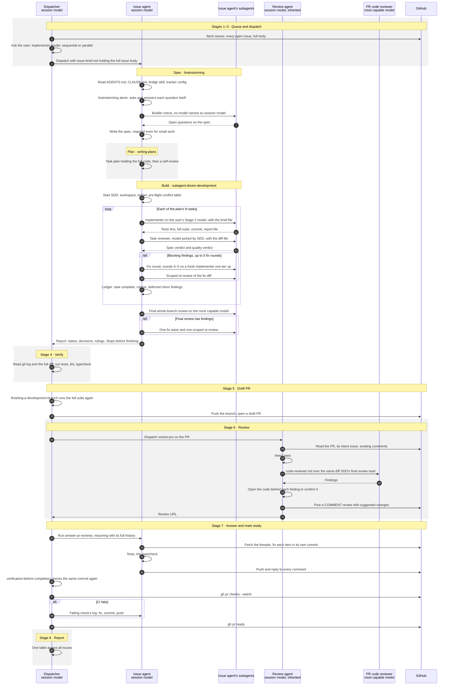
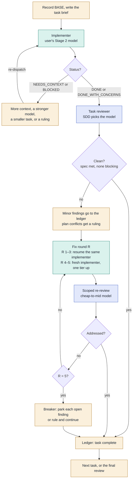
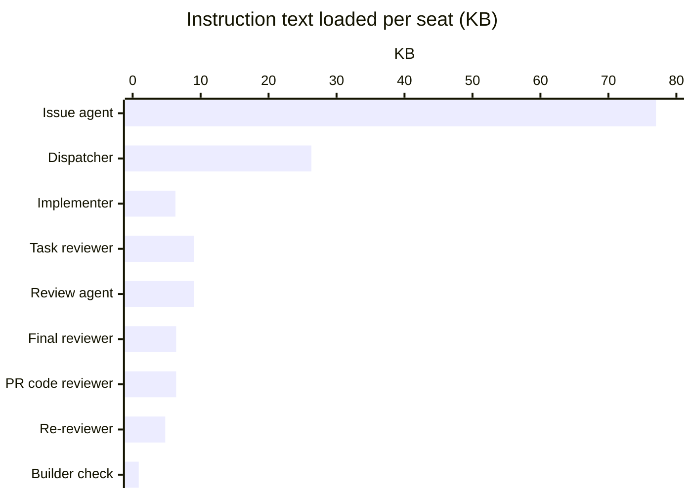
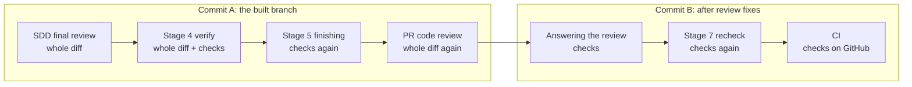

# How implement-issues builds one issue

This traces one issue through `implement-issues`, from the queue to a ready
pull request. It covers every agent the skill starts, which model each one runs
on, what each one loads, and where the same work repeats. Use it as the map
when you change the skill's cost or speed, or the models it uses.

It describes the skills as written: `implement-issues`, `review-prs`,
`answer-pr-reviews`, `fetch-issues` and `superpowers-issue-bridge` from this
repo, plus Superpowers 7.0.0's `brainstorming`, `writing-plans`,
`subagent-driven-development` (SDD), `requesting-code-review`,
`receiving-code-review`, `finishing-a-development-branch` and
`verification-before-completion`. When one of those skills changes, update
this file too.

## At a glance

For one issue whose plan has N tasks:

| | |
| --- | --- |
| Agents started, before any fix round | **2N + 5** |
| Full reads of the same branch diff after the build | **3** |
| Full test, lint and typecheck runs after the build | **4 + CI**, on two commits |
| Model seats the user can set today | **1 of 12**, the implementer |

## Who runs what

Time runs downward. Each column is one agent. The shaded bands are the
skill's stages. In the participant names, "session model" means the model
of the session that started the run, used because nothing names another one.

### Stage by stage

1. **Build the queue** — dispatcher, session model.
   - `fetch-issues` lists every open issue with its full body, up to 1,000.
     All of it stays in the dispatcher's context for the whole run.
   - The dispatcher reads the tracker config and skips issues that already
     have a PR or branch.
   - It orders dependent issues and fetches the base branch.
2. **Ask two questions** — dispatcher.
   - Which model the implementers use. This is the only model choice in the
     whole flow.
   - Sequential or parallel, and how many at once.
3. **Dispatch the issue agent** — dispatcher.
   - Creates `feat/<ref>-<slug>` and its worktree.
   - Fills `issue-brief.md` with the full issue body.
   - Starts the issue agent in the background, on the session model.
4. **Spec** — issue agent.
   - Reads `AGENTS.md` and `CLAUDE.md`, loads `superpowers-issue-bridge`, and
     reads the tracker config again.
   - Runs `brainstorming` alone. That skill was written for a conversation, so
     the agent asks itself each question and answers it from the issue and
     the code.
   - Writes a spec even when the work is small, because the plan needs one.
   - Brainstorming also starts a builder-check subagent, which names no model,
     so it runs on the session model.
5. **Plan** — issue agent.
   - `writing-plans` writes a task-by-task plan. When the work is clear, each
     task holds the complete code to write.
   - The agent then self-reviews the plan against the spec.
6. **Build with SDD** — issue agent as controller, plus subagents.
   - Loads the 32.6 KB SDD skill, creates a ledger, and writes a pre-flight
     conflict table covering every task.
   - Runs the task loop below once per task.
   - After the last task: a final whole-branch review on the most capable
     model, plus one fix wave if it finds anything.
   - Reports its rulings and stops before `finishing-a-development-branch`.
7. **Verify** — dispatcher.
   - Reads `git log` and the full diff, then runs tests, lint and typecheck.
   - On a failure, sends one message back to the issue agent.
8. **Open a draft PR** — dispatcher.
   - `finishing-a-development-branch` runs the full suite again on the same
     commit.
   - Pushes, and opens the draft with the body from `pr-body.md`.
9. **Review the PR** — a new review agent, on the session model.
   - Runs `review-prs`: reads the PR, its intent issue and the existing
     comments, then does the intent pass itself.
   - The code pass starts `code-reviewer.md` on the most capable model.
   - It opens the code behind each finding to confirm it, then posts a
     `COMMENT` review.
10. **Answer and mark ready** — issue agent, then dispatcher.
    - The issue agent resumes with its whole history and runs
      `answer-pr-reviews` and `receiving-code-review`.
    - It commits each fix separately, runs the checks, pushes, and replies to
      every comment.
    - The dispatcher checks that same commit again and waits for CI.
    - It sends CI failures back to the issue agent, then runs `gh pr ready`.
11. **Report** — dispatcher. One table across all issues, then one question
    for each PR that left work undone.

## The per-task loop

This loop runs inside SDD once per plan task, so its cost grows with N. The
number of fix rounds grows with how often the reviewer finds something.

Colors: amber is the issue agent on the session model, teal is the user's
implementer model, and blue is a model SDD picks by task size.

## Every model seat

| Seat | How many | Model today | Who decides |
| --- | --- | --- | --- |
| Dispatcher | 1 per run | session | The user, when they start the session |
| Issue agent (spec, plan, SDD controller) | 1 per issue | session | `implement-issues` requires it |
| Builder check | 1 | session | Nobody: no model is named, so it inherits |
| Implementer | N | the user's Stage 2 choice | The user, one model for every task |
| Task reviewer | N | mid-tier at least | SDD |
| Scoped re-reviewer | 1 per fix round | cheap to mid | SDD |
| Escalated fixer, rounds 4–5 | 0–2 per task | one tier above the implementer | SDD |
| Final whole-branch reviewer | 1 | most capable | SDD |
| Final fix wave | 0–1 | SDD's judgment | SDD |
| Review agent | 1 | session | Nobody: no model is named, so it inherits |
| PR code reviewer | 1 | most capable | `review-prs` |
| Review answerer | 1, the reused issue agent | session | `implement-issues` |

## What each seat loads

This counts skill and prompt text only, measured from the installed files on
17 October 2026. Code, diffs, issue bodies and test output come on top of it.
Tokens are estimated at four characters per token.

| Seat | Runs | KB | ≈ tokens | Made of |
| --- | --- | ---: | ---: | --- |
| Issue agent | 1, held all run | 77.0 | 19k | SDD 32.6, writing-plans 10.3, brainstorming 10.1, bridge 7.7, answer-pr-reviews 7.1, receiving-code-review 6.2, issue brief 3.0 |
| Dispatcher | 1 per run | 26.3 | 7k | implement-issues 10.6, finishing-a-development-branch 7.8, fetch-issues 4.3, verification-before-completion 3.6 |
| Implementer | N | 6.3 | 2k | implementer prompt, plus 9.6 when its task tells it to use test-driven-development |
| Task reviewer | N | 9.0 | 2k | task-reviewer prompt |
| Review agent | 1 | 9.0 | 2k | review-prs 6.0, requesting-code-review 3.0 |
| Final reviewer | 1 | 6.4 | 2k | code-reviewer.md |
| PR code reviewer | 1 | 6.4 | 2k | code-reviewer.md, the same file |
| Re-reviewer | 1 per fix round | 4.8 | 1k | re-review prompt |
| Builder check | 1 | 0.9 | <1k | builder-check prompt |

The issue agent builds up its 77 KB over one long life. Every turn it takes
after loading SDD re-reads all of it.

## Where the same work repeats

These are the steps after the last task. The implementers also ran the full
suite before each of their commits.

| Step | Reads the whole diff | Runs the full checks | Commit checked |
| --- | :---: | :---: | --- |
| SDD final review | yes | | |
| Stage 4 verify | yes | yes | A, the built branch |
| Stage 5 finishing | | yes | A again |
| PR code review | yes | | |
| Answering the review | | yes | B, after review fixes |
| Stage 7 recheck | | yes | B again |
| CI | | yes | B, on GitHub |

## Likely hot spots

This is a reading of the skills. Nothing here has been measured from a real
run yet.

- **Expensive seats by default.** The issue agent, the builder check and the
  review agent run on the session model only because nothing names another
  one. Two reviewers are required to use the most capable model.
- **Code written twice.** The plan already holds the code, and the
  implementers write it again. For a one-task issue, brainstorming, a spec, a
  plan and SDD add up to a lot of process.
- **Two identical reviews.** SDD's final review and the `review-prs` code pass
  run the same `code-reviewer.md` over the same diff, both on the most
  capable model.
- **Checks of a commit already checked.** Stages 4 and 5 both run the full
  checks on commit A. The Stage 7 recheck repeats the run `answer-pr-reviews`
  just did on commit B.
- **A heavy context brought back.** The issue agent answers the review while
  still carrying its brainstorm, plan and SDD bookkeeping. A fresh agent would
  start with only the PR.
- **One model for every task.** SDD wants a cheap model for tasks that are
  pure transcription and a stronger one for integration work.
  `implement-issues` replaces that with a single choice.
